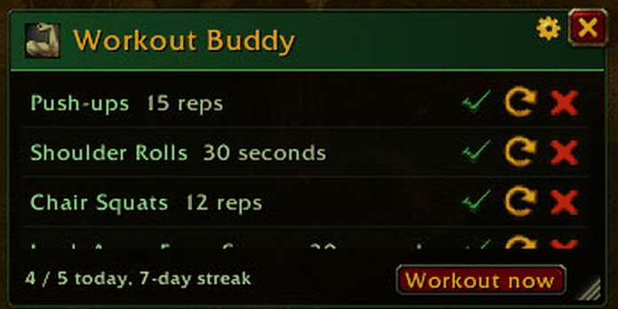

# Workout Buddy

A World of Warcraft addon that turns moments in the game into short exercise, stretch and water breaks. Level up, kill a boss, sit in a queue or simply play for 45 minutes, and Workout Buddy adds a quick workout to a small queue window. Tick it off when you have done it and watch your daily goal and streak grow.

Works on **WoW Forever**, **Midnight (Retail)** and **Classic Era** from the same download.



## Features

- **Workout triggers:** level up, XP bubbles, boss kills, Mythic+ completions, quest turn-ins, achievements, deaths, zone changes and a play-time break timer. Options a game client does not support are hidden automatically.
- **Custom triggers:** pick any game event, add health or rest-area conditions, or write a short Lua condition.
- **Set workouts per action:** each potion, healthstone, death or other event can always add a specific workout (3 push-ups per mana potion, 5 burpees per death). Repeats add up, and a recap after each boss fight and instance shows the totals.
- **Queue window:** mark workouts done, log part of one, or skip it. Opens by itself during downtime (flights, queues, quest turn-ins, going AFK) and never in the middle of combat.
- **Hydration reminders:** goal-based or fixed interval, ounces or milliliters, with one-click logging.
- **Quiet hours:** pause or silence workouts and hydration at set times of day (for example no workouts after 10 PM), with separate schedules, days of the week, and local or realm time.
- **Stats:** daily goal, streaks, active days, totals per activity and water, by day, week, month, all time or a custom range.
- **Workout library:** desk-friendly cardio, stretching, posture, strength, eye and breathing exercises, and healthy habits.
- **Profiles and sharing:** per-character or shared profiles, plus import and export of workout lists and whole profiles.

## Commands

| Command | What it does |
| --- | --- |
| `/wob` | Open settings |
| `/wob show` | Show or hide the workout queue |
| `/wob now` | Get a workout right now |
| `/wob water` | Log a drink of water |
| `/wob stats` | Print today's progress |
| `/wob pause`, `/wob resume` | Pause or resume automatic suggestions |
| `/wob quiet` | Show quiet hours status |
| `/wob demo` | Sample data for screenshots; run again (or reload) to restore your real data |
| `/wob center` | Move the windows back to the middle of the screen |
| `/wob minimap` | Show or hide the minimap button |

Minimap button: left-click toggles the queue, shift-click gives a workout now, right-click opens settings.

## Installing manually

Extract the zip so the folder `WorkoutBuddy` sits inside your game's AddOns folder, for example:

- WoW Forever: `World of Warcraft\_forever_\Interface\AddOns\WorkoutBuddy`
- Midnight (Retail): `World of Warcraft\_retail_\Interface\AddOns\WorkoutBuddy`
- Classic Era: `World of Warcraft\_classic_era_\Interface\AddOns\WorkoutBuddy`

## For developers

### Layout

| File | Purpose |
| --- | --- |
| `WorkoutBuddy.lua` | Addon object, saved-variable defaults and migration, client compatibility helpers, suggestions, slash commands |
| `events.lua` | Built-in workout triggers and the play-time timer |
| `trigger_manager.lua` | Custom triggers (the only place they are dispatched from) |
| `item_use.lua` | "I use an item or spell" matching: bag lookup from use-spell to item, presets |
| `wow_events.lua` | Event catalog and help text for the trigger editor |
| `stats.lua` | Workout and water history, summaries, goal and streak |
| `hydration.lua` | Hydration timer and popup |
| `quiet_hours.lua` | Quiet hours schedules (local or realm clock) |
| `demo.lua` | `/wob demo` screenshot mode (swaps in sample data, restores on exit or logout) |
| `media/` | Screenshots and the CurseForge description (not packaged); `scripts/media.py` collects, crops and builds GIFs |
| `Sounds.lua` | Sound registration through LibSharedMedia |
| `reminder_frame/` | Queue window: state, queue, auto-open events, UI |
| `ui/` | Settings window (own UI kit, no AceConfig/AceGUI): `widgets.lua` themes and widgets, `window.lua` navigation, search and page renderer, `page_*.lua` and `pages.lua` the pages |
| `trigger_list.lua` | One list of built-in and custom triggers for the Triggers page, with validation |
| `sharing.lua`, `workout_library.lua` | Import/export (never runs code) and the built-in exercise library |
| `minimap_button.lua` | LibDataBroker launcher, minimap button, addon compartment |

### Client compatibility rules

- Register events only through `WorkoutBuddy.SafeRegisterEvent` or after `WorkoutBuddy.IsEventValid`, because each client has a different event set and registering an unknown event is an error.
- Check values from unit APIs with `WorkoutBuddy.IsSecret` before comparing them or doing math. Modern clients (Forever and Midnight) can return secret values.
- Use `C_AddOns`, `C_Timer` and other namespaced APIs, with fallbacks where a client may lack them.

### Tests

The `tests` folder runs the addon in a Lua VM with a mocked game client (no game needed). It needs Node.js.

```
cd tests
npm install
npm test
```

`npm test` checks Lua syntax, verifies every file the TOC loads exists, loads the addon with all libraries, fires game events, and exercises suggestions, triggers, hydration, stats, imports, options and slash commands, plus an upgrade from older saved data.

### Releasing

Releases are built by CurseForge's automatic packager from this repository (see `.pkgmeta`).

1. Update `CHANGELOG.md`.
2. Commit and push to `main`.
3. Tag the commit and push the tag:

   ```
   git tag 2.1.0
   git push origin 2.1.0
   ```

   A tag containing `beta` (for example `2.1.1-beta1`) publishes a beta, and one containing `alpha` publishes an alpha. The tag becomes the addon's version number.

To build an installable zip on your own machine (for a manual upload or local testing), run `python scripts/build_zip.py 2.1.0`. It follows the same rules as `.pkgmeta` and writes `dist/WorkoutBuddy-2.1.0.zip`.

The TOC's `## Interface` line lists every client the addon supports (`16001` Forever, `120105` and `120107` Midnight, `11509` Classic Era). Update it when a game patch changes the interface number.

## License

Workout Buddy is free to use, modify and share under the MIT License (see `LICENSE`). The bundled libraries in `Libs/` keep their own licenses.

Contributions and bug reports are welcome through GitHub issues and pull requests.
