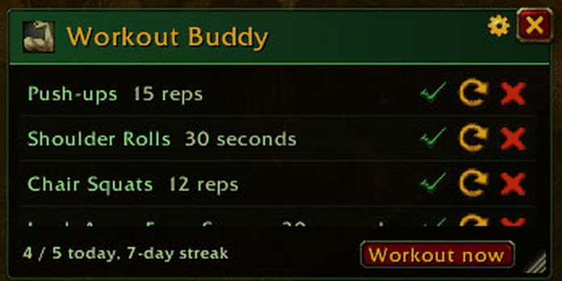
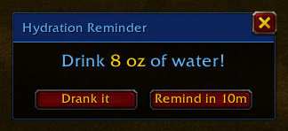
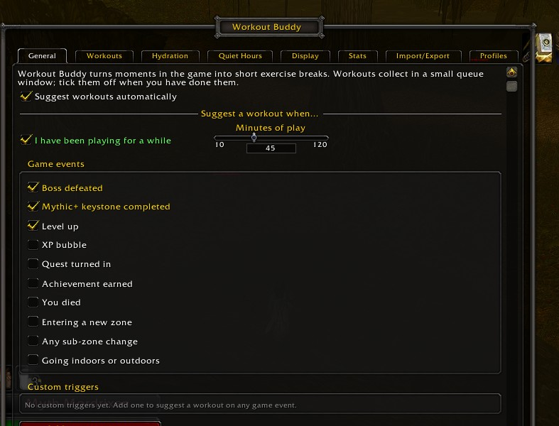
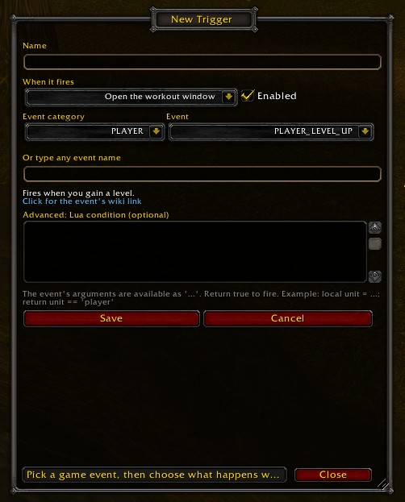

# Workout Buddy

**Turns boss kills, deaths, flights and long play sessions into quick exercise, stretch and water breaks.** Free, lightweight, and it never interrupts you in combat.

## Why

Gaming sessions are long and chairs are comfortable. Workout Buddy hands you a small, doable workout at natural moments: a boss goes down, you level up, you die (push-ups build character), or you have simply been playing for 45 minutes. Tick it off when you are done and watch your daily goal and streak grow.

## Features

- **Workouts at the right moments:** boss kills, Mythic+ completions, level ups, XP bubbles, quest turn-ins, achievements, deaths, zone changes, or a play-time break timer.
- **A small queue window** that opens during downtime (flights, dungeon and battleground queues, going AFK) and never in the middle of a fight.
- **Hydration reminders** on a daily goal or a fixed interval, in ounces or milliliters, with one-click logging.
- **Quiet hours:** no workouts after 10 PM? Keep water reminders but silence them? Set separate schedules for workouts and hydration, by day of the week, on your local or realm clock.
- **Stats:** daily goal, streaks, active days and totals by day, week, month or all time.
- **Workout library** of desk-friendly exercises, stretches, eye breaks and healthy habits. Edit, add or share your own list.
- **Custom triggers** on any game event, with health or rest-area conditions.
- **Set workouts per action:** 3 push-ups per mana potion, 5 burpees per death. Repeats add up, and a recap after each boss fight and dungeon or raid shows the totals.

## Commands

| Command | What it does |
| --- | --- |
| `/wob` | Open settings |
| `/wob show` | Show or hide the workout queue |
| `/wob now` | Get a workout right now |
| `/wob water` | Log a drink of water |
| `/wob stats` | Print today's progress |
| `/wob pause`, `/wob resume` | Pause or resume automatic suggestions |
| `/wob quiet` | Show quiet hours status |

Minimap button: left-click toggles the queue, shift-click gives a workout now, right-click opens settings.

## Works on

WoW Forever, Midnight (Retail) and Classic Era, from one download.

Found a bug or have an idea? Open an issue on [GitHub](https://github.com/AzkabanAdmin/WorkoutBuddy/issues).
